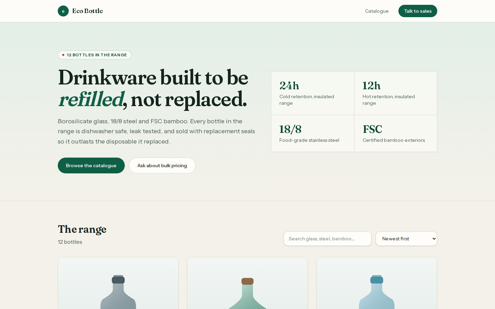
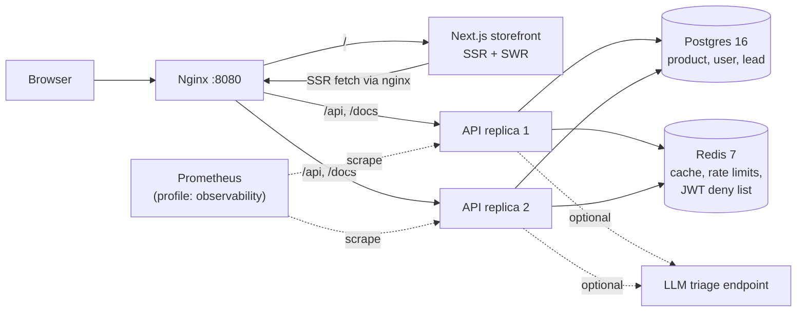
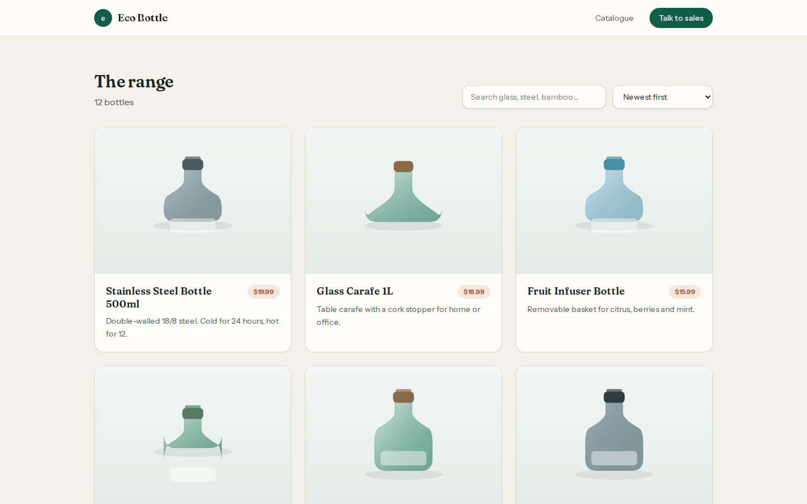
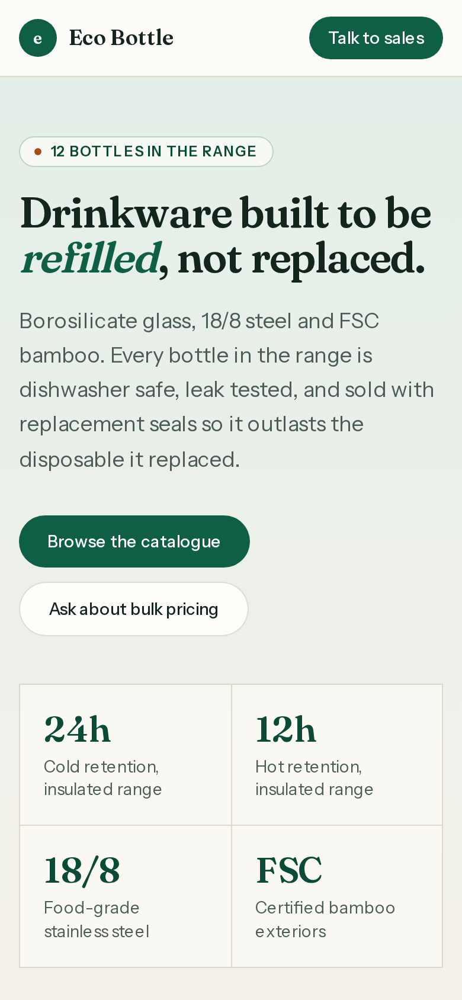
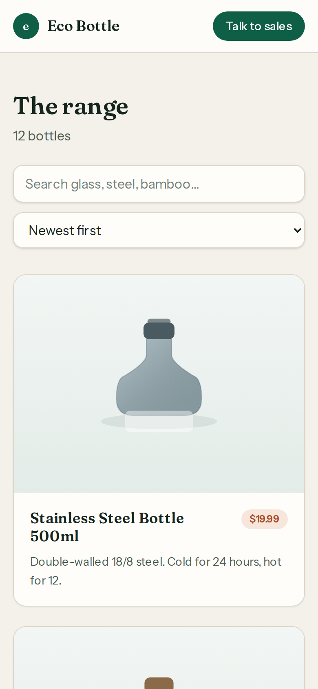
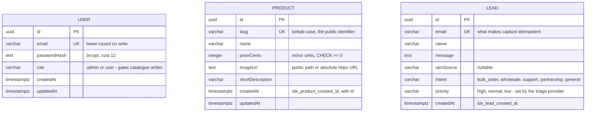
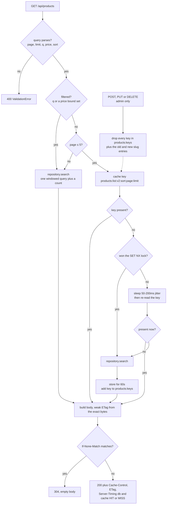
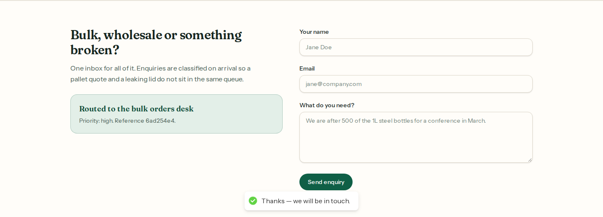

# Eco Bottle

A storefront and sales inbox for a reusable-drinkware brand. A Next.js landing
page browses the catalogue and takes enquiries; an Express API behind Nginx
serves the catalogue from Postgres through a Redis cache, and classifies every
enquiry on arrival so a pallet quote does not wait behind a leaking lid.

It is deliberately small in scope (a catalogue and a lead funnel, no checkout)
and deliberately complete in the parts it has: two API replicas sharing their
rate limits and token deny list, ETags and a stampede-safe cache on the read
path, migrations instead of `synchronize`, and a test suite that drives the real
Express app.



## Get it running

Everything runs in containers with one command. You need Docker with Compose v2.

```bash
make up          # same as: docker compose up --build
```

Then open <http://localhost:8080>. Compose starts Postgres and Redis, applies
the migration, seeds 12 products and an admin account, starts two API replicas,
the storefront and Nginx in front of them. `make down` stops it and deletes the
volumes. The first build needs network access: besides the npm registry,
`next/font` downloads the two typefaces once and serves them from the app.

### Working on the code

For hot reload, run the apps from your shell against the Compose datastores.
This needs Node 22 (`.nvmrc`) and pnpm 9 via `corepack enable`.

```bash
pnpm install
docker compose up -d postgres redis

cp apps/backend/.env.example apps/backend/.env
pnpm --filter backend migration:run
pnpm --filter backend seed     # 12 products, one admin account

pnpm --filter backend dev      # http://localhost:4000, Swagger UI at /docs
pnpm --filter frontend dev     # http://localhost:3000  (second terminal)
```

`make help` lists every target. Redis is optional here: leave `REDIS_URL` unset
and the cache, rate limiter and deny list fall back to in-process implementations
with a warning at boot, which is only correct for
[one replica](#where-redis-earns-its-keep).

## How it fits together



The browser only ever talks to one origin, so there is no CORS preflight and no
API host baked into the client. Server-side rendering reaches the API through the
same Nginx from inside the network.

## The storefront

One page: a hero, the catalogue and the enquiry form.

- **Catalogue.** Search is debounced (one request per pause, not per keystroke),
  sort covers newest, price both ways and name, and a pager walks the whole
  catalogue twelve at a time. The first page is rendered on the server and handed
  to SWR as its starting data.
- **States.** Skeleton cards while loading, an explained empty state with a
  "Clear filters" action, and an error panel with a retry. If the server cannot
  reach the API while rendering, the page still renders and the grid loads from
  the browser rather than claiming the catalogue is empty.
- **Enquiry form.** Its Zod schema mirrors the API's limits (a test holds them
  together), and the receipt shows the triage verdict the API returned.
- **Type and colour.** Fraunces for headings and Instrument Sans for text, on a
  warm paper background with forest green for actions and fired clay for prices.
  Self-hosted by `next/font`, so the browser makes no third-party requests.
- **Access.** A skip link, labelled landmarks, the grid as a list of articles,
  visible focus outlines, and motion that respects `prefers-reduced-motion`.



| Phone, 390x844                                                        | Same width, catalogue                                                                             |
| --------------------------------------------------------------------- | ------------------------------------------------------------------------------------------------- |
|  |  |

## What the API exposes

Public reads, admin-only writes. The seed creates `admin@example.com` /
`Passw0rd!`, both overridable via `SEED_ADMIN_EMAIL` / `SEED_ADMIN_PASSWORD`.
Change them before seeding anything reachable.

| Method   | Path                          | Who    | Notes                                                                              |
| -------- | ----------------------------- | ------ | ---------------------------------------------------------------------------------- |
| `GET`    | `/api/products`               | anyone | `page` `limit` `q` `minPriceCents` `maxPriceCents` `sort`. ETag + `Server-Timing`. |
| `GET`    | `/api/products/:slug`         | anyone | 404 for an unknown slug, and the miss is cached too                                |
| `POST`   | `/api/products`               | admin  | 409 if the slug is taken                                                           |
| `PUT`    | `/api/products/:id`           | admin  | 409 on a rename onto a taken slug; drops the old and new slug from the cache       |
| `DELETE` | `/api/products/:id`           | admin  |                                                                                    |
| `POST`   | `/api/leads`                  | anyone | 5/minute per IP, idempotent on email, returns the triage verdict                   |
| `GET`    | `/api/leads`                  | admin  | the inbox                                                                          |
| `POST`   | `/api/auth/register`          | anyone | 409 if the email is taken                                                          |
| `POST`   | `/api/auth/login`             | anyone | 15-minute HS256 access token                                                       |
| `POST`   | `/api/auth/logout`            | token  | records the `jti` on a deny list until it expires                                  |
| `GET`    | `/api/auth/me`                | token  |                                                                                    |
| `GET`    | `/health` `/ready` `/metrics` | anyone | liveness, dependency check, Prometheus                                             |
| `GET`    | `/docs`                       | anyone | Swagger UI over `apps/backend/openapi.yaml`                                        |

`/health`, `/ready` and `/metrics` are exempt from the global rate limit. Leaving
them in the counter means a fixed-interval scrape eventually rate-limits the
application it is monitoring, and the healthcheck that starts failing is exactly
what makes an orchestrator restart a container that was fine.

Uniqueness is checked before a write and enforced by the database. When two
requests race past the check, the error handler turns the Postgres unique
violation into the same 409, not a 500.

### What the responses look like

Captured through Nginx on the Compose stack; ids and timings will differ.

```console
$ curl -s 'localhost:8080/api/products?limit=2&sort=price_asc'
{"items":[{"id":"52fcefbd-43dc-4978-9c33-a0a7ee856c6f","slug":"kids-bottle-300ml",
  "name":"Kids Bottle 300ml","priceCents":999,"imageUrl":"/products/kids-300.svg",
  "shortDescription":"Light, drop-tested, and dishwasher safe.",
  "createdAt":"2026-11-08T03:31:48.209Z","updatedAt":"2026-11-08T03:31:48.209Z"},
  {"id":"90bf36bc-…","slug":"travel-mug-350ml","name":"Travel Mug 350ml","priceCents":1299,…}],
 "total":12,"page":1,"limit":2,"pages":6}

$ curl -s localhost:8080/api/leads -H 'content-type: application/json' -d '{
    "name": "Jane Doe", "email": "jane@acme-supplies.example",
    "message": "We need a quote for 500 units of the 1L steel bottle for a conference in March."}'
{"id":"7802390a-dd61-4915-9165-db82c225199c","intent":"bulk_order","priority":"high"}   # 201
# the same email again returns the same receipt with 200 and writes nothing

$ curl -s 'localhost:8080/api/products?minPriceCents=2000&maxPriceCents=1000'
{"error":"ValidationError","message":"Request failed validation","requestId":"0f30df64-…",
 "details":{"formErrors":[],"fieldErrors":{"minPriceCents":["minPriceCents must not exceed maxPriceCents"]}}}

$ curl -s localhost:8080/api/products -H "authorization: Bearer $TOKEN" \
    -H 'content-type: application/json' -d '{"slug":"travel-mug-350ml", …}'
{"error":"Conflict","message":"A product with slug \"travel-mug-350ml\" already exists","requestId":"55696288-…"}

$ curl -s 'localhost:8080/api/leads?limit=1' -H "authorization: Bearer $TOKEN"
{"items":[{"id":"7802390a-…","email":"jane@acme-supplies.example","name":"Jane Doe",
  "message":"We need a quote for 500 units …","utmSource":null,"intent":"bulk_order",
  "priority":"high","triageSource":"rules","createdAt":"2026-11-08T03:32:05.297Z"}],
 "total":1,"page":1,"limit":1}
```

Every error has the same shape, and `requestId` matches the `x-request-id`
response header, which Nginx and both replicas carry through.

## What it stores

Three tables, no foreign keys between them — the catalogue, the account list and
the lead inbox are genuinely independent, and inventing a join to make the diagram
look busier would only be a lie about the schema.



Money is `integer` minor units — no float touches a price anywhere, and a
`CHECK (priceCents >= 0)` backs the Zod rule up at the database.
`idx_product_created_id` is composite on `(createdAt, id)` to match the
catalogue's `ORDER BY createdAt DESC, id DESC`; `id` is a tiebreak, not
decoration, because without it two rows sharing a timestamp can swap places
between page one and page two and a visitor sees one product twice and never sees
another. The unique constraints on `slug` and `email` build their own indexes, so
nothing declares a second `@Index` over the same column.

`synchronize` is off everywhere. Schema changes go through
`apps/backend/src/migrations`.

## How a catalogue request is served

The read path is the most load-bearing thing here, so it gets the diagram.
Filtered queries always hit Postgres, the plain catalogue is cached, and only one
caller ever runs the query on a cold key.



Both "not cached" branches are one argument: a key encoding free text and two
price bounds has an effectively infinite key space, nobody repeats an arbitrary
search, so caching it speeds up nothing and lets any client write unlimited
entries that are never read again. `?page=9999` is the same hole with a crawler
walking it. `Server-Timing` makes the outcome observable from devtools:

```
$ curl -sD- -o/dev/null 'http://localhost:4000/api/products?limit=3' | grep -i server-timing
Server-Timing: db;dur=6, cache;desc="MISS"

$ curl -sD- -o/dev/null 'http://localhost:4000/api/products?limit=3' | grep -i server-timing
Server-Timing: cache;desc="HIT"
```

## Where Redis earns its keep

The stack runs **two** API replicas behind Nginx, and that is the whole
justification. Three things live in the shared store, and two of them are
outright broken without it:

| What                      | Why it cannot be per-process                                                                                                                                            |
| ------------------------- | ----------------------------------------------------------------------------------------------------------------------------------------------------------------------- |
| Rate-limit counters       | Nginx spreads requests across both replicas. A per-process counter hands every client twice its budget, and four times it at four replicas.                             |
| JWT deny list             | Logout records the token's `jti`. In-process, the token stays valid on whichever replica did not handle the logout.                                                     |
| Product list/detail cache | The only one that is a pure optimisation. A 12-row catalogue does not need it — it is here because it is the piece that has to survive a replica restart and be shared. |

`MemoryCacheStore` implements the same `CacheStore` port for a single process, and
the app says so at boot rather than pretending the guarantees still hold:
`REDIS_URL not set — using an in-process cache. Do not run more than one replica.`

## Sorting an inbound enquiry

The lead form is the only write path a stranger can reach, and "bulk quote for 800
units" should not land in the same queue as "my lid is leaking". Every lead is
classified on arrival and stored with an `intent` and a `priority`.



Classification sits behind a `LeadTriageProvider` port with two adapters.
**`RuleLeadTriage`** is the default: phrase patterns per intent, then a priority
score that also weighs whether the sender's domain is a free mail provider —
deterministic, offline, no key, eight tests of its own. **`LlmLeadTriage`** is optional; set
`LEAD_TRIAGE_PROVIDER=llm` and `LEAD_TRIAGE_API_KEY` to route through an
OpenAI-compatible chat endpoint. The model's reply is _validated against the label
enum_ before it is trusted, and a timeout, a bad key, an unparseable body or an
invented label all fall through to the rule engine, and the stored row then reads
`triageSource: "rules-fallback"`, so the inbox shows which leads a model never saw.

**A lead is never lost because a model was unreachable**, and the repo runs end to
end with no API key. Four triage tests exist purely to pin that fallback.

## Layout

```
apps/backend/src
  ports/        the five interfaces: CacheStore, the three repositories,
                and LeadTriageProvider
  adapters/     cache/ (redis, memory)  db/ (typeorm)
                memory/ (test doubles)  triage/ (rules, llm)
  services/     catalogue, leads, auth, cache, rate limiting: the logic
  routes/       validation and status codes only, one file per resource
  middleware/   auth, errors, rate limit, timeout, ETag, request id
  container.ts  picks the adapters and wires them together
  migrations/   the schema

apps/frontend
  app/(site)/   the landing page and its chrome
  components/   Hero, Catalogue, EnquiryForm, ProductCard, ui/
  lib/          api client, product types, the shared lead schema, and tests

infra/docker    the three Dockerfiles, nginx.conf, prometheus.yml
tests/load.yml  the Artillery scenario
```

Routes reach the database only through a repository port, which is what lets the
suite drive the real Express app against in-memory repositories, and holds both
implementations to the same pagination and filter contract. Both halves are
strict TypeScript (`strict`, plus `noUncheckedIndexedAccess` on the backend) on
Express 5 and Zod 4, linted by ESLint 9 flat config: one at the root, one in
`apps/frontend` because `eslint-config-next` brings its own rules.

## Configuration

`apps/backend/.env.example` and `apps/frontend/.env.example` list every variable
with its default. Four are worth calling out: `JWT_SECRET` and `FRONTEND_ORIGIN`
both make the app **refuse to boot** in production if unset or left at the
development default, rather than signing tokens with a public string or
reflecting whatever `Origin` arrives; `REDIS_URL` unset means in-process stores
and a single replica; and `NEXT_PUBLIC_API_URL` is inlined at build time, so
changing it needs a rebuild rather than a restart.

Every operating limit lives in `apps/backend/src/config/constants.ts`: 600
requests per IP per minute globally, 5 per minute on `POST /api/leads`, a 12-item
default page with a 100-item ceiling, a 5-second request timeout, a 256 kB body
limit, a 15-minute access token.

## Tests

```
$ pnpm test
apps/frontend test:  Test Files  2 passed (2)
apps/frontend test:       Tests  12 passed (12)
apps/backend test:   Test Files  5 passed (5)
apps/backend test:        Tests  74 passed (74)
```

The backend files drive the real Express app through supertest against in-memory
adapters, so the suite needs no containers and finishes in about five seconds.
The regressions they pin: pagination never repeating or skipping a row;
`?page=abc` and an inverted price range rejected rather than reaching SQL; the
cache reporting MISS then HIT, filtered queries staying uncached, and a 404
being remembered rather than re-queried; `If-None-Match` producing a 304; a
non-admin getting 403 on a catalogue write; a duplicate or renamed-onto slug
getting 409; a renamed slug dropping its old cache entry; login answering
identically for a wrong password and an unknown account; a token stopping at
logout; lead capture staying idempotent and returning 429 with `Retry-After`;
the triage source being stored; one loader running under eight concurrent
misses; a stalled request timing out with 503; and the LLM adapter falling back
to rules on every failure mode.

The frontend tests cover the pieces with logic in them: the catalogue URL builder
that SSR and the browser must agree on, price formatting, image path resolution,
the lead schema's agreement with the API's limits, and the fetch wrapper's rule
of retrying a dropped connection but never a 4xx.

`pnpm check` (or `make check`) runs lint, typecheck and both test suites.

## Load profile

`tests/load.yml` is an Artillery scenario for the read path, weighted 7:3 between
browsing and searching. `make load-test` runs it against a live API and writes
`reports/run.html`. Artillery is fetched on demand with `pnpm dlx` rather than
installed: as a devDependency it pulled a Chromium download into every install.

One local run against the backend directly — loopback, macOS, one API process,
Postgres 16 and Redis 7 on the same machine. Not a claim about production
hardware:

```
http.codes.200: 433      vusers.failed: 0
http.request_rate: 19/sec
http.response_time: median 2ms   p95 4ms   p99 7.9ms   max 22ms
```

The arrival rates are deliberately below the API's own limiter: Artillery drives
every virtual user from one source address, so anything above 600 requests per
minute measures the rate limiter rather than the application and reports the
resulting 429s as failures.

## The container stack

```bash
make up      # docker compose up --build
make down    # and delete the volumes
```

Eight services: `postgres`, `redis`, a `migrate` job, a `seed` job, `backend-1`,
`backend-2`, `frontend`, and `nginx` on `localhost:8080` (`HTTP_PORT` moves it).
Prometheus sits behind a profile (`docker compose --profile observability up`)
and scrapes both replicas directly; scraping through the proxy would report one
replica's numbers as the whole service's.

Both application images are multi-stage on Node 22 and run as the `node` user
under `tini`, so `SIGTERM` reaches the process and the graceful shutdown in
`src/index.ts` actually runs. `pnpm-lock.yaml` is committed and both builds use
`--frozen-lockfile`. `migrate` runs to completion before either replica starts,
so no boot races the schema. The Nginx image tests its own config at build time;
because nginx resolves upstream hostnames while testing, Compose gives that build
stand-in entries for the services that do not exist yet.

## What is deliberately not here

- **No orders, cart, stock or checkout.** This is a catalogue and a lead funnel —
  nothing to decrement, nothing to charge — rather than a half-built one.
- **No refresh tokens.** Access tokens last 15 minutes and logout uses a deny
  list. A refresh flow needs rotation and reuse detection to be worth having.
- **No product detail page in the UI**, and **no alerting** on the metrics
  Prometheus collects.
- **No admin UI.** Catalogue writes and the lead inbox are API-only, behind an
  admin token; `/docs` is the console for them.

## License

MIT, see [LICENSE](LICENSE).
