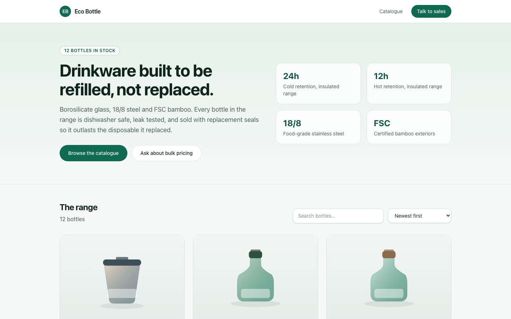
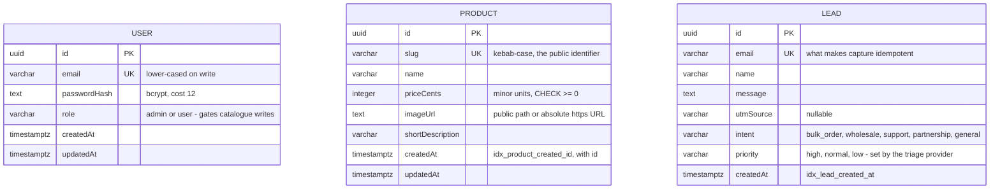
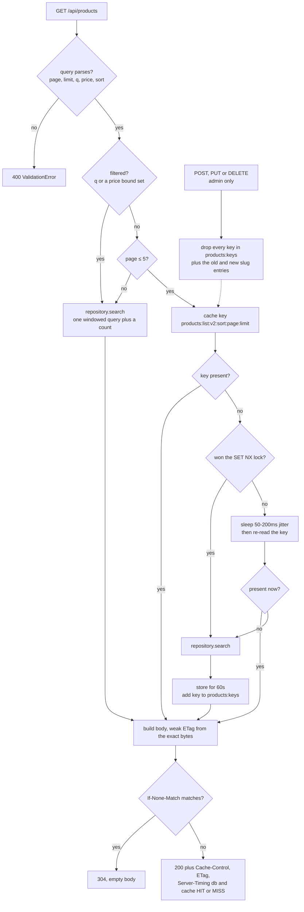
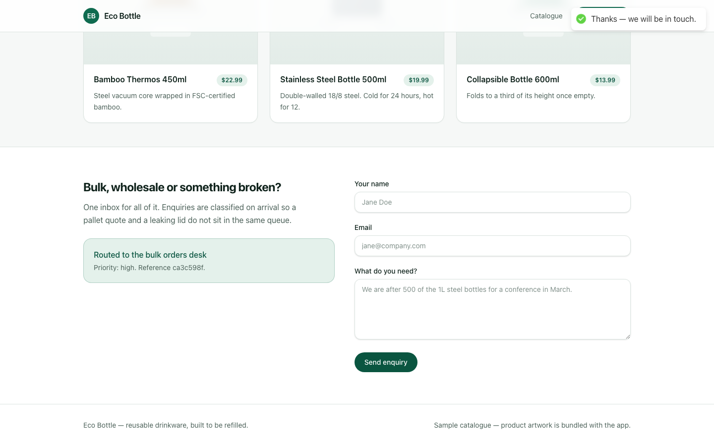

# Eco Bottle

A reusable-drinkware storefront: a Next.js landing page over an Express catalogue
API, with Postgres, Redis, two API replicas behind Nginx, and a lead inbox that
classifies enquiries as they arrive.
[](package.json)
[](pnpm-workspace.yaml)
[](apps/backend/tsconfig.json)
[](apps/backend/src/test)
[](.github/workflows/ci.yml)
[](LICENSE)



---

## Get it running

Two processes and two datastores — the datastores from Compose, the apps from
your shell:

```bash
pnpm install
docker compose up -d postgres redis

cp apps/backend/.env.example apps/backend/.env
pnpm --filter backend migration:run
pnpm --filter backend seed     # 12 products, one admin account

pnpm --filter backend dev      # http://localhost:4000
pnpm --filter frontend dev     # http://localhost:3000  (second terminal)
```

`make help` lists every target. Redis is optional here — leave `REDIS_URL` unset
and the cache, rate limiter and deny list fall back to in-process implementations
with a warning at boot, which is only correct for
[one replica](#where-redis-earns-its-keep). The whole stack in containers,
Nginx included, is [one command](#the-container-stack).

### Native PostgreSQL when Docker is unavailable

Use Node 22 and a running PostgreSQL server (version 16 was exercised locally).
Create an empty database owned by your local user and configure its URL before
running the migration and seed:

```bash
export DATABASE_URL=postgresql://localhost/eco_bottle
createdb eco_bottle
export JWT_SECRET=replace-with-your-local-random-signing-key
export FRONTEND_ORIGIN=http://localhost:3000
pnpm --filter backend migration:run
pnpm --filter backend seed
pnpm --filter backend dev
# In a second terminal:
pnpm --filter frontend dev
```

No Redis is needed for this one-process demonstration. A native browser enquiry
was persisted once in PostgreSQL and classified by the local rules provider;
[verification details](docs/native-flow-verification.json) record that scope.
[The receipt](docs/screenshots/lead-receipt.png) and
[mobile view](docs/screenshots/storefront-mobile.png) were captured from the running
services. The full multi-replica container topology was not exercised here.

## What the API exposes

Public reads, admin-only writes. The seed creates `admin@example.com` /
`Passw0rd!`, both overridable via `SEED_ADMIN_EMAIL` / `SEED_ADMIN_PASSWORD`.

| Method   | Path                          | Who    | Notes                                                                              |
| -------- | ----------------------------- | ------ | ---------------------------------------------------------------------------------- |
| `GET`    | `/api/products`               | anyone | `page` `limit` `q` `minPriceCents` `maxPriceCents` `sort`. ETag + `Server-Timing`. |
| `GET`    | `/api/products/:slug`         | anyone | 404 for an unknown slug, misses cached too                                         |
| `POST`   | `/api/products`               | admin  |                                                                                    |
| `PUT`    | `/api/products/:id`           | admin  | drops the cached entry for both the old and new slug                               |
| `DELETE` | `/api/products/:id`           | admin  |                                                                                    |
| `POST`   | `/api/leads`                  | anyone | 5/minute per IP, idempotent on email, returns the triage verdict                   |
| `GET`    | `/api/leads`                  | admin  | the inbox                                                                          |
| `POST`   | `/api/auth/register`          | anyone | 409 if the email is taken                                                          |
| `POST`   | `/api/auth/login`             | anyone | 15-minute HS256 access token                                                       |
| `POST`   | `/api/auth/logout`            | token  | records the `jti` on a deny list until it expires                                  |
| `GET`    | `/api/auth/me`                | token  |                                                                                    |
| `GET`    | `/health` `/ready` `/metrics` | anyone | liveness, dependency check, Prometheus                                             |
| `GET`    | `/docs`                       | anyone | Swagger UI over `apps/backend/openapi.yaml`                                        |

`/health`, `/ready` and `/metrics` are exempt from the global rate limit. Leaving
them in the counter means a fixed-interval scrape eventually rate-limits the
application it is monitoring — and the healthcheck that starts failing is exactly
what makes an orchestrator restart a container that was fine.

## What it stores

Three tables, no foreign keys between them — the catalogue, the account list and
the lead inbox are genuinely independent, and inventing a join to make the diagram
look busier would only be a lie about the schema.



Money is `integer` minor units — no float touches a price anywhere, and a
`CHECK (priceCents >= 0)` backs the Zod rule up at the database.
`idx_product_created_id` is composite on `(createdAt, id)` to match the
catalogue's `ORDER BY createdAt DESC, id DESC`; `id` is a tiebreak, not
decoration, because without it two rows sharing a timestamp can swap places
between page one and page two and a visitor sees one product twice and never sees
another. The unique constraints on `slug` and `email` build their own indexes, so
nothing declares a second `@Index` over the same column.

`synchronize` is off everywhere. Schema changes go through
`apps/backend/src/migrations`.

## How a catalogue request is served

The read path is the most load-bearing thing here, so it gets the diagram.
Filtered queries always hit Postgres, the plain catalogue is cached, and only one
caller ever runs the query on a cold key.



Both "not cached" branches are one argument: a key encoding free text and two
price bounds has an effectively infinite key space, nobody repeats an arbitrary
search, so caching it speeds up nothing and lets any client write unlimited
entries that are never read again. `?page=9999` is the same hole with a crawler
walking it. `Server-Timing` makes the outcome observable from devtools:

```
$ curl -sD- -o/dev/null 'http://localhost:4000/api/products?limit=3' | grep -i server-timing
Server-Timing: db;dur=6, cache;desc="MISS"

$ curl -sD- -o/dev/null 'http://localhost:4000/api/products?limit=3' | grep -i server-timing
Server-Timing: cache;desc="HIT"
```

## Where Redis earns its keep

The stack runs **two** API replicas behind Nginx, and that is the whole
justification. Three things live in the shared store, and two of them are
outright broken without it:

| What                      | Why it cannot be per-process                                                                                                                                            |
| ------------------------- | ----------------------------------------------------------------------------------------------------------------------------------------------------------------------- |
| Rate-limit counters       | Nginx spreads requests across both replicas. A per-process counter hands every client twice its budget, and four times it at four replicas.                             |
| JWT deny list             | Logout records the token's `jti`. In-process, the token stays valid on whichever replica did not handle the logout.                                                     |
| Product list/detail cache | The only one that is a pure optimisation. A 12-row catalogue does not need it — it is here because it is the piece that has to survive a replica restart and be shared. |

`MemoryCacheStore` implements the same `CacheStore` port for a single process, and
the app says so at boot rather than pretending the guarantees still hold:
`REDIS_URL not set — using an in-process cache. Do not run more than one replica.`

## Sorting an inbound enquiry

The lead form is the only write path a stranger can reach, and "bulk quote for 800
units" should not land in the same queue as "my lid is leaking". Every lead is
classified on arrival and stored with an `intent` and a `priority`.



Classification sits behind a `LeadTriageProvider` port with two adapters.
**`RuleLeadTriage`** is the default: phrase patterns per intent, then a priority
score that also weighs whether the sender's domain is a free mail provider —
deterministic, offline, no key, eight tests. **`LlmLeadTriage`** is optional; set
`LEAD_TRIAGE_PROVIDER=llm` and `LEAD_TRIAGE_API_KEY` to route through an
OpenAI-compatible chat endpoint. The model's reply is _validated against the label
enum_ before it is trusted, and a timeout, a bad key, an unparseable body or an
invented label all fall through to the rule engine — the stored row then reads
`triageSource: "rules-fallback"`.

**A lead is never lost because a model was unreachable**, and the repo runs end to
end with no API key. Four triage tests exist purely to pin that fallback.

## Layout

```
apps/backend/src
  ports/        the five interfaces: CacheStore, the three repositories,
                and LeadTriageProvider
  adapters/     cache/ (redis, memory)  db/ (typeorm)
                memory/ (test doubles)  triage/ (rules, llm)
  services/     catalogue, leads, auth, cache, rate limiting — the logic
  routes/       validation and status codes only, one file per resource
  middleware/   auth, errors, rate limit, timeout, ETag, request id
  container.ts  picks the adapters and wires them together
  migrations/   the schema

apps/frontend
  app/(site)/   the landing page and its chrome
  components/   Hero, Catalogue, EnquiryForm, ProductCard, ui/
  lib/          api client, product types, the shared lead schema
```

Routes reach the database only through a repository port, which is what lets the
suite drive the real Express app against in-memory repositories — and holds both
implementations to the same pagination and filter contract. Both halves are
strict TypeScript (`strict`, plus `noUncheckedIndexedAccess` on the backend),
linted by ESLint 9 flat config: one at the root, one in `apps/frontend` because
`eslint-config-next` brings its own rules.

## Configuration

`apps/backend/.env.example` and `apps/frontend/.env.example` list every variable
with its default. Four are worth calling out: `JWT_SECRET` and `FRONTEND_ORIGIN`
both make the app **refuse to boot** in production if unset or left at the
development default, rather than signing tokens with a public string or
reflecting whatever `Origin` arrives; `REDIS_URL` unset means in-process stores
and a single replica; and `NEXT_PUBLIC_API_URL` is inlined at build time, so
changing it needs a rebuild rather than a restart.

Every operating limit lives in `apps/backend/src/config/constants.ts`: 600
requests per IP per minute globally, 5 per minute on `POST /api/leads`, a 12-item
default page with a 100-item ceiling, a 5-second request timeout, a 256 kB body
limit, a 15-minute access token.

## Tests

```
$ pnpm test
 Test Files  5 passed (5)
      Tests  61 passed (61)
```

Five files, all driving the real Express app through supertest against in-memory
adapters, so the suite finishes in about five seconds with no containers. The
regressions they pin: pagination never repeating or skipping a row; `?page=abc`
rejected rather than becoming `OFFSET NaN`; the cache reporting MISS then HIT and
filtered queries staying uncached; `If-None-Match` producing a 304; a non-admin
getting 403 on a catalogue write; a renamed slug dropping its old cache entry;
login answering identically for a wrong password and an unknown account; a token
stopping at logout; lead capture staying idempotent and returning 429 with
`Retry-After`; one loader running under eight concurrent misses; and the LLM
adapter falling back to rules on every failure mode.

`pnpm check` runs lint, typecheck and tests — the same three steps as CI.

## Load profile

`tests/load.yml` is an Artillery scenario for the read path, weighted 7:3 between
browsing and searching. `make load-test` runs it against a live API and writes
`reports/run.html`.

One local run against the backend directly — loopback, macOS, one API process,
Postgres 16 and Redis 7 on the same machine. Not a claim about production
hardware:

```
http.codes.200: 433      vusers.failed: 0
http.request_rate: 19/sec
http.response_time: median 2ms   p95 4ms   p99 7.9ms   max 22ms
```

The arrival rates are deliberately below the API's own limiter: Artillery drives
every virtual user from one source address, so anything above 600 requests per
minute measures the rate limiter rather than the application and reports the
resulting 429s as failures.

## The container stack

```bash
make up      # docker compose up --build
make down    # and delete the volumes
```

Eight services: `postgres`, `redis`, a `migrate` job, a `seed` job, `backend-1`,
`backend-2`, `frontend`, and `nginx` on `localhost:8080`. Prometheus sits behind a
profile (`docker compose --profile observability up`) and scrapes both replicas
directly — scraping through the proxy would report one replica's numbers as the
whole service's.

Both application images are multi-stage and run as the `node` user under `tini`,
so `SIGTERM` reaches the process and the graceful shutdown in `src/index.ts`
actually runs. `pnpm-lock.yaml` is committed and both builds use
`--frozen-lockfile` — a lockfile that only exists on one laptop makes every image
build a different image. `migrate` runs to completion before either replica
starts, so no boot races the schema and no boot can drop it.

## What is deliberately not here

- **No orders, cart, stock or checkout.** This is a catalogue and a lead funnel —
  nothing to decrement, nothing to charge — rather than a half-built one.
- **No refresh tokens.** Access tokens last 15 minutes and logout uses a deny
  list. A refresh flow needs rotation and reuse detection to be worth having.
- **No product detail page in the UI**, and **no alerting** on the metrics
  Prometheus collects.

## License

MIT — see [LICENSE](LICENSE).

## Author

[**Muhammad Nadeem**](https://github.com/dev-mnadeem)
